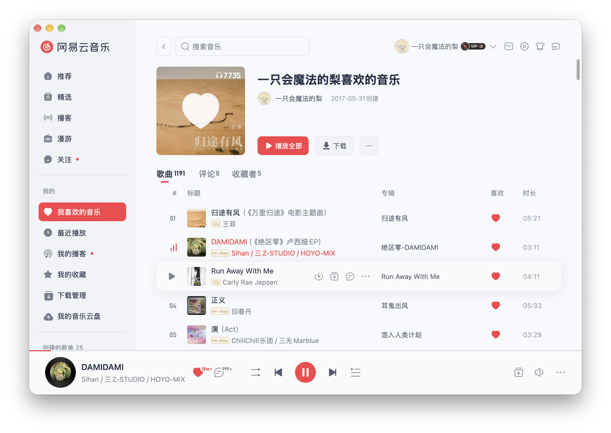

# NetEase-Music-GPUI

使用 Rust 和 [GPUI](https://gpui.rs/) 复刻网易云音乐桌面界面的练手项目，逐步接入真实账号、歌单和歌曲播放，学习原生 UI、共享状态与异步音频处理。

项目仍在开发中，主要在 macOS 上开发和验证，其他平台尚未验证。



> [!TIP]
> 是的，你没有看错！这不是原版而是 GPUI 原生实现！！


## 当前功能

- **登录和听歌**：使用网易云音乐 App 扫码登录，查看个人歌单和「我喜欢的音乐」，选择歌曲播放。
- **发现音乐**：浏览每日推荐、推荐歌单和私人雷达，也可以开启心动模式，听红心歌曲和相似推荐。
- **管理播放**：查看播放队列、插入下一首，选择循环、随机播放和音质；播放进度和设置会保留到下次使用。
- **看歌词和评论**：展开播放页欣赏旋转唱片和逐行歌词，点击歌词跳转，还可以查看歌曲评论。
- **整理歌单**：收藏歌曲、创建歌单，在歌单中搜索和排序。

## 运行

需要较新的 Rust stable 工具链、Python 3.9+、Git 和网络连接。macOS 编译环境还需要 Xcode Command Line Tools。

在项目根目录运行：

```bash
python3 scripts/prepare_gpui.py
cargo run --locked
```

准备脚本下载固定版本的 GPUI 并应用本地补丁（图片 GPU 旋转、背景模糊、SVG 应用字体）；首次构建和补丁更新后运行即可。
仓库只保存补丁，生成的依赖源码不进入 Git。详情见 [GPUI 补丁说明](vendor/README.md)。

启动后使用网易云音乐 App 扫码登录。登录会话保存在本地，请勿分享或提交 `session.cookie`。

## 打包

在目标平台运行以下命令，产物位于 `target/bundle/`（Windows 可用 `py -3`）：

```bash
python3 scripts/package.py
```

macOS 生成 `.app`，Windows 生成 ZIP，Linux 生成 `tar.gz`。请分发完整的应用或压缩包；Linux 包需要兼容的系统库和图形环境。构建选项和平台说明见 [打包脚本说明](scripts/README.md)。

## 技术栈

| 依赖 | 用途 |
| --- | --- |
| GPUI / gpui-kit | 原生窗口、布局、组件与 Entity 状态管理 |
| ncm-api-rs | 网易云账号、歌单、歌曲详情和播放地址接口 |
| Tokio / reqwest | 异步网络请求与音频下载 |
| CPAL | 音频设备与直接 PCM 输出 |
| Symphonia | 音频格式解析、跳转和可报告错误的后台解码 |
| serde / serde_json | API 数据解析 |

音频下载直接使用标准 `reqwest`；GPUI 图片请求使用 `reqwest-client` 适配器。适配器内部依赖 `gpui-pre-reqwest` 分支，因此两者各自复用客户端和连接池。

## 项目结构

`api/` 负责接口，`models/` 负责类型和解析，`state/` 持有共享数据，`ui/` 订阅数据并渲染，`playback/` 管理队列、音频和缓存。页面进入时后台刷新，已有内容保留到新数据返回。

架构约定与播放链路见 [docs/architecture.md](docs/architecture.md)。开发时默认向控制台输出请求状态与耗时，可用 `RUST_LOG=warn,netease_music_gpui=debug cargo run --locked` 调整日志级别。

## 开发验证

```bash
python3 scripts/prepare_gpui.py
cargo fmt --check
cargo check --locked --all-targets
cargo clippy --locked --all-targets -- -D warnings
cargo test --locked
```

## 当前限制

- 高音质取决于账号权限和歌曲资源；接口可能返回较低音质、试听片段，或因权限和下架状态无法播放。
- 磁盘音频缓存预算为 2 GiB，单曲上限为 512 MiB。服务器不支持 Range 时回退到顺序下载，未下载位置仍需要等待。
- MP3 为避免从头扫描采用 Coarse 跳转，VBR 文件的定位可能近似。
- 播放队列暂不支持排序和删除。
- 下载、分享等功能以及部分页面仍是占位；歌单支持本地歌曲搜索和虚拟评论列表，收藏者标签尚未实现内容加载。
