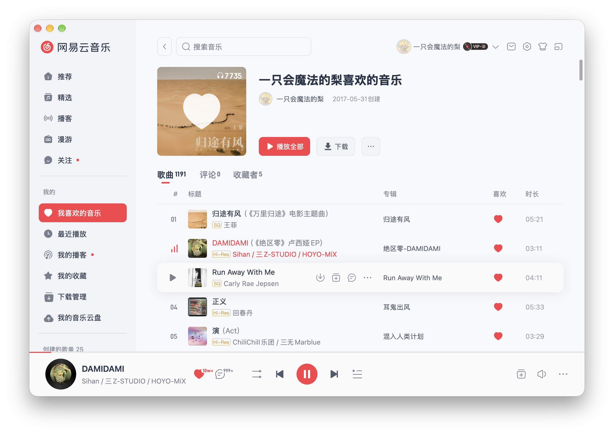

# netease-music-gpui

使用 Rust 和 [GPUI](https://gpui.rs/) 复刻网易云音乐桌面界面的练手项目，逐步接入真实账号、歌单和歌曲播放，学习原生 UI、共享状态与异步音频处理。

项目仍在开发中，主要在 macOS 上开发和验证，其他平台尚未验证。



> [!TIP]
> 是的，你没有看错！这不是原版而是 GPUI 原生实现！！


## 当前功能

- 点击顶部头像或昵称，用网易云音乐 App 扫码登录；保存会话并恢复账号资料、头像和会员信息，支持退出登录。
- 推荐页展示每日推荐入口、推荐歌单、私人雷达和精选活动，支持刷新与打开歌单。
- 加载个人歌单与「我喜欢的音乐」，展示真实歌曲、封面、创建者和喜欢状态；支持收藏歌曲及创建歌单后收藏。
- 虚拟化歌曲列表，支持排序和拖动标题／专辑列分界线。
- 歌单列表的音质徽章取 `song_detail` 的 `privileges.playMaxBrLevel`，标出平台为这首歌提供的最高档位（含超清母带、臻音、沉浸声、全景声）；该字段不随登录态变化，实际能否播放仍取决于账号权限。
- 选歌、播放全部、暂停／继续、上一首／下一首，以及播完自动播放下一首。
- 播放列表独立于页面歌单：选歌时复制一份，洗牌、插入和之后的页面变化都只影响它。
- 播放队列侧面板支持查看队列、选歌、下一首插入和收藏。
- 心动模式：登录后点击推荐页入口，混合播放红心歌曲与相似推荐，临近队尾自动补曲；支持失败重试、取消与退出，并随播放记录恢复。
- 四种播放方式：顺序播放、单曲循环、列表循环、随机播放（切换到随机时把列表洗一遍，之后按这个顺序播）；播放栏左侧按钮循环切换，选择随播放缓存保留。
- 选择的音质同样写入播放缓存，下次启动沿用。
- HTTP Range 分段缓存和后台解码，拖动后优先下载目标区间；切换页面不会停止播放。
- 播放控制接口支持接口提供的全部九档音质，播放栏提供常用音质选项；实际返回的音质可能随账号权限和资源降级。
- 播放失败后点击播放可重试，音量气泡支持拖动调整音量。
- 播放栏展示歌曲信息、红心计数和评论计数。
- 展开专辑歌词页后显示旋转唱片、逐行歌词和译文；支持点击歌词跳转、手动滚动后恢复跟随，以及歌曲评论分页加载。

## 运行

需要较新的 Rust stable 工具链、Python 3.9+、Git 和网络连接。macOS 编译环境还需要 Xcode Command Line Tools。

在项目根目录运行：

```bash
python3 scripts/prepare_gpui.py
cargo run --locked
```

准备脚本下载固定版本的 GPUI 并应用本地补丁（图片 GPU 旋转、背景模糊、SVG 应用字体）；首次构建和补丁更新后运行即可。
仓库只保存补丁，生成的依赖源码不进入 Git。详情见 [GPUI 补丁说明](vendor/README.md)。

启动后点击顶部头像或昵称，使用网易云音乐 App 扫描二维码并在手机上确认。二维码过期或请求失败时可以刷新；关闭扫码窗口会停止轮询。登录成功后自动加载个人歌单，下次启动恢复登录。再次点击头像可退出登录，删除本地会话并清空账号和个人歌单状态；播放队列与播放记录保留。

扫码凭据原子保存到应用数据目录的 `session.cookie`：macOS 为 `~/Library/Application Support/NeteaseMusicGpui/`，Windows 为 `%APPDATA%/NeteaseMusicGpui/`，Linux 为 `$XDG_DATA_HOME/netease-music-gpui/`（默认 `~/.local/share/netease-music-gpui/`）。Unix 文件权限为 `0600`，内容是未加密的登录 Cookie，请勿分享该文件。

早先的 `COOKIE` 环境变量启动凭据已移除：未保存会话时启动会直接进入登录窗。

应用不会读取 `.env`。Cookie 属于登录凭据，请勿提交到仓库。

二维码接口可以单独检查（需要网络，只请求未授权二维码，不使用账号凭据）：

```bash
cargo test --locked qr_endpoint_returns_pending_login -- --ignored
```

心动模式需要「我喜欢的音乐」非空，推荐顺序由服务端生成。进入后按推荐顺序播放；再次点击入口、播放栏红心模式按钮或队列中的「退出」可结束心动模式，恢复此前的普通播放方式。播放其他歌单、清空队列或切换账号也会结束心动会话。暂停期间收到的新推荐不会自动开播。补曲失败可在入口或队列中重试；播放权限仍以账号和歌曲资源为准。

心动接口回归测试（需要登录会话和非空红心歌单）：

```bash
cargo test --locked heart_mode_can_load_real_recommendations -- --ignored
```

## 打包

在 macOS 或 Windows 上安装 Python 3.9+，运行以下命令构建当前平台的 release 并复制资源（Windows 也可以使用 `py -3`）：

```bash
python3 scripts/package.py
```

macOS 生成 `target/bundle/NetEase Music.app`，可执行文件位于 `Contents/MacOS`，图标、图片和字体位于 `Contents/Resources/assets`；Windows 生成 `target/bundle/netease-music-gpui/`，里面包含 `.exe` 和 `assets/`。如果配置了自定义 Cargo target 目录，产物位于该目录的 `bundle/`。请分发完整应用包或目录，不要只复制可执行文件。脚本只构建本机平台，不负责交叉编译、制作安装程序或收集额外的 Windows 运行库。

所有项目资源都从外部目录读取。单独执行 `cargo build --release` 不会复制资源，应使用上述脚本生成可分发目录。

macOS 包使用本地 ad-hoc 签名，没有 Developer ID 签名和公证。可以双击应用并扫码登录，无需配置环境变量。

## 技术栈

| 依赖 | 用途 |
| --- | --- |
| GPUI / gpui-kit | 原生窗口、布局、组件与 Entity 状态管理 |
| ncm-api-rs | 网易云账号、歌单、歌曲详情和播放地址接口 |
| Tokio / reqwest | 异步网络请求与音频下载 |
| CPAL | 音频设备与直接 PCM 输出 |
| Symphonia | 音频格式解析、跳转和可报告错误的后台解码 |
| serde / serde_json | API 数据解析 |

音频下载直接使用标准 `reqwest`；GPUI 图片请求使用 `reqwest-client` 适配器。适配器内部依赖 `gpui-pre-reqwest` 分支，因此两者各自复用客户端和连接池。

## 项目结构

`api/` 负责接口，`models/` 负责类型和解析，`state/` 持有共享数据，`ui/` 订阅数据并渲染，`playback/` 管理队列、音频和缓存。页面进入时后台刷新，已有内容保留到新数据返回。

架构约定与播放链路见 [docs/architecture.md](docs/architecture.md)。开发时默认向控制台输出请求状态与耗时，可用 `RUST_LOG=warn,netease_music_gpui=debug cargo run --locked` 调整日志级别。

## 开发验证

```bash
python3 scripts/prepare_gpui.py
cargo fmt --check
cargo check --locked --all-targets
cargo clippy --locked --all-targets -- -D warnings
cargo test --locked
```

## 当前限制

- 高音质取决于账号权限和歌曲资源；接口可能返回较低音质、试听片段，或因权限和下架状态无法播放。
- 磁盘音频缓存预算为 2 GiB，单曲上限为 512 MiB。服务器不支持 Range 时回退到顺序下载，未下载位置仍需要等待。
- MP3 为避免从头扫描采用 Coarse 跳转，VBR 文件的定位可能近似。
- 播放队列暂不支持排序和删除。
- 下载、分享等功能以及部分页面仍是占位；歌单支持本地歌曲搜索和虚拟评论列表，收藏者标签尚未实现内容加载。
